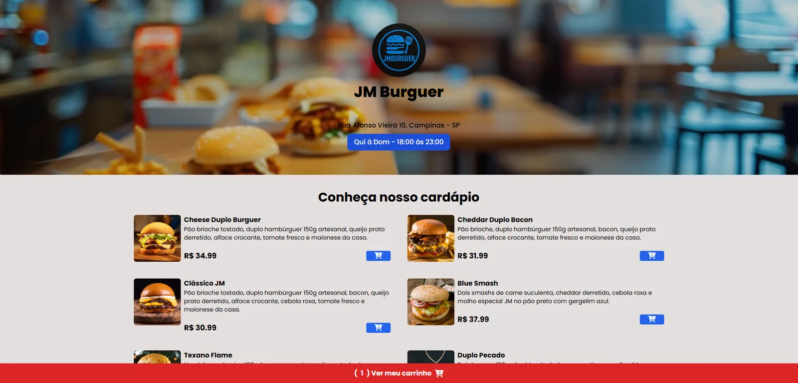

# JM Burguer

Cardápio online de uma hamburgueria, com carrinho de compras. Projeto de portfólio.

**Site:** https://projeto-hamburgueria-five.vercel.app/



## Funcionalidades

- Cardápio de lanches e bebidas com botão para adicionar ao carrinho
- Carrinho salvo no navegador (`localStorage`): o pedido continua lá ao recarregar a página
- Contador de itens no rodapé e aviso a cada item adicionado
- Remoção de itens, limpeza do carrinho e total calculado automaticamente
- Endereço obrigatório antes de finalizar, com o último endereço usado já preenchido
- Escolha da forma de pagamento: dinheiro, cartão de crédito, débito ou PIX

## Tecnologias

- HTML
- Tailwind CSS (compilado com a CLI do Tailwind e PostCSS)
- JavaScript

## Rodar localmente

O CSS já compilado está em `dist/output.css`, então basta abrir o `index.html` no navegador.

Para editar os estilos do Tailwind:

```bash
npm install
npm run dev
```

O `npm run dev` recompila o `dist/output.css` sempre que o HTML muda.

## Observação

A JM Burguer é uma marca criada para este projeto. Endereço, horários e preços são fictícios.

## Autor

João Marcos Ribeiro · [Portfólio](https://joaomarcos-jhn.github.io/portfolio/) · [LinkedIn](https://www.linkedin.com/in/jo%C3%A3o-marcos-ribeiro-088580347/)
